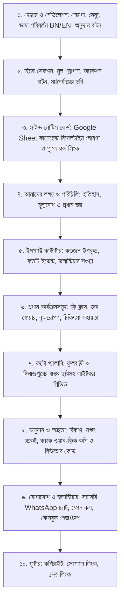

# Product Requirement Document (PRD) & Technical Architecture
## প্রকল্প: জনতা-দেশবন্ধু ফাউন্ডেশন (Janata-Deshbondhu Foundation) অফিসিয়াল ওয়েবসাইট

---

## ১. নির্বাহী সারসংক্ষেপ ও ভিশন (Executive Summary & Vision)
* **সংগঠনের নাম:** জনতা-দেশবন্ধু ফাউন্ডেশন (Janata-Deshbondhu Foundation)
* **মূল কাজের এলাকা:** দিনাজপুর জেলা (বিশেষ করে ফুলবাড়ী উপজেলা ও আশপাশের গ্রামীণ অঞ্চল)।
* **উদ্দেশ্য:** গ্রামীণ সুবিধাবঞ্চিত শিক্ষার্থীদের মানসম্মত শিক্ষা, গণিত-ইংরেজি বেসিক ক্লাস, ক্যারিয়ার মেন্টরশিপ, বিনামূল্যে চিকিৎসা ও ওষুধ বিতরণ, বৃক্ষরোপণ এবং যেকোনো মানবিক দুর্যোগে ত্রাণ সহায়তা প্রদান।
* **ওয়েবসাইটের প্রধান লক্ষ্য:**
  1. সংগঠনের লক্ষ্য, ভিশন ও মাঠপর্যায়ের কার্যক্রম মানুষের সামনে তুলে ধরা।
  2. সাধারণ মানুষ ও প্রবাসীদের মধ্যে বিশ্বাসযোগ্যতা (Trust & Transparency) তৈরি করা।
  3. ডোনেশনের জন্য স্বচ্ছ মোবাইল ব্যাংকিং (bKash, Nagad, Rocket) ও ব্যাংক অ্যাকাউন্ট বিবরণী ওয়ান-ক্লিক কপি সুবিধাসহ উপস্থাপন করা।
  4. চলমান নোটিস, ফ্রি ক্লাস ও কোর্স রেজিস্ট্রেশন (Google Form লিংক) সহজে প্রচার করা।
  5. নতুন ভলান্টিয়ার ও শুভাকাঙ্ক্ষীদের সরাসরি WhatsApp ও ফোনের মাধ্যমে যুক্ত করা।
* **বাজেট ও খরচ সীমা:** **১০০% আজীবন ফ্রি (Zero Cost Forever)**। কোনো সার্ভার বা ডেটাবেস খরচ থাকবে না।

---

## ২. ব্যবহারকারী ও অডিয়েন্স প্রোফাইল (Target Audience)
1. **সুবিধাবঞ্চিত শিক্ষার্থী ও অভিভাবক:** ফ্রি ক্লাস, বৃত্তি ও নোটিস সংক্রান্ত তথ্য জানার জন্য।
2. **শুভাকাঙ্ক্ষী ও দাতা (Donors - দেশি ও প্রবাসী):** কার্যক্রমের স্বচ্ছতা দেখে ফান্ড অনুদান দেওয়ার জন্য।
3. **তরুণ ভলান্টিয়ার ও মেন্টর:** বিভিন্ন বিশ্ববিদ্যালয় ও মেডিকেলের শিক্ষার্থী যারা নিজেদের এলাকাকে এগিয়ে নিতে স্বেচ্ছাসেবী হিসেবে যোগ দিতে চান।

---

## ৩. ফাংশনাল রিকোয়ারমেন্টস (Features & Page Sections)

ওয়েবসাইটটি একটি উচ্চমানের, আধুনিক ও মোবাইল-ফ্রেন্ডলি **Single-Page Web Application** হবে, যেখানে নিচের সেকশনগুলো থাকবে:

### সেকশনভিত্তিক বিস্তারিত বিবরণ:

#### ১. হেডার ও নেভিগেশন (Header & Navbar):
* ফাউন্ডেশনের অফিশিয়াল লোগো এবং নাম।
* সেকশন নেভিগেশন লিংক: *পরিচিতি*, *কার্যক্রম*, *নোটিস বোর্ড*, *গ্যালারি*, *অনুদান*, *যোগাযোগ*।
* **Language Toggle:** [বাংলা / English] এক ক্লিকে সম্পূর্ণ সাইটের ভাষা পরিবর্তন।
* **CTA Button:** উজ্জ্বল রঙের "অনুদান দিন / Donate" বাটন।
* মোবাইল ডিভাইসে স্মুথ হ্যামবার্গার ড্রয়ার মেনু।

#### ২. হিরো সেকশন (Hero Banner):
* শক্তিশালী ও মানবিক স্লোগান: *"শিক্ষায় আলো, মানবতার সেবায় পাশে — গড়বো আগামীর সম্ভাবনাময় বাংলাদেশ" / "Spreading Light of Education, Serving Humanity"*.
* ফুলবাড়ীর ক্লাস কার্যক্রমের বাস্তব ছবিযুক্ত ভিজ্যুয়াল ব্যানার।
* প্রধান দুটি কল-টু-অ্যাকশন: "আমাদের কার্যক্রম দেখুন" এবং "সহায়তার হাত বাড়ান"।

#### ৩. লাইভ নোটিস বোর্ড (Live Notice Board via Google Sheets):
* **Dynamic CMS Integration:** ফাউন্ডেশনের একটি গুগল শিটের সাথে সরাসরি লিংকড।
* শিটে নতুন কোনো রো (Row) যোগ করা হলে সাইটে তাৎক্ষণিক নতুন নোটিস কার্ড প্রদর্শিত হবে:
  * নোটিসের ধরন (নতুন ব্যাচ / জরুরি নোটিস / ঘোষণা)।
  * শিরোনাম ও সংক্ষিপ্ত বিবরণ।
  * অ্যাকশন বাটন: যেমন **"রেজিস্ট্রেশন করুন (Google Form)"** বা **"বিস্তারিত দেখুন"**।
* শিট ফাঁকা থাকলে বা অফলাইনে সুন্দর ডিফল্ট স্ট্যাটাস ("বর্তমানে নতুন কোনো নোটিস নেই") প্রদর্শিত হবে।

#### ৪. আমাদের লক্ষ্য ও পরিচিতি (About & Core Pillars):
* কীভাবে ফুলবাড়ী, দিনাজপুরে এই মানবিক যাত্রার সূচনা হয়েছিল।
* ৪টি প্রধান স্তম্ভ:
  1. **শিক্ষা ও মেন্টরশিপ:** প্রাথমিক ও মাধ্যমিক শিক্ষার্থীদের ফ্রি বেসিক শিক্ষা ও গাইডেন্স।
  2. **স্বাস্থ্য ও চিকিৎসা সহায়তা:** দরিদ্র মানুষের চিকিৎসায় আর্থিক ও লজিস্টিক সহায়তা।
  3. **পরিবেশ ও বৃক্ষরোপণ:** সবুজ গ্রাম ও পরিবেশ রক্ষা আন্দোলন।
  4. **যুব উন্নয়ন ও ক্যারিয়ার নির্দেশনা:** কর্মশালা, আইটি দক্ষতা ও জব ফেয়ার ইনফরমেশন।

#### ৫. ইমপ্যাক্ট কাউন্টার (Impact Metrics):
* সংখ্যায় আমাদের অর্জন (যেমন: ৫০০+ শিক্ষার্থী উপকৃত, ৫০+ ভলান্টিয়ার, ১০+ শিক্ষা কর্মসূচি, ১০০% স্বচ্ছতা)।

#### ৬. প্রধান কার্যক্রমসমূহ (Our Programs):
* প্রতিটি কার্যক্রমের জন্য কার্ড (আইকন, বিবরণ, বিগত কাজের বিবরণ)।
* সরাসরি ফেসবুক পেজের সংশ্লিষ্ট পোস্টের লিংক।

#### ৭. ইন্টারেক্টিভ ফটো গ্যালারি (Photo Gallery & Lightbox):
* ফাউন্ডেশনের আসল কাজের ছবিগুলো (ইতিমধ্যে প্রাপ্ত ৩০+ হাই-রেজুলেশন ছবি থেকে ফিল্টার করা)।
* ক্যাটাগরি ফিল্টার: *সকল*, *ক্লাস কার্যক্রম*, *বৃক্ষরোপণ*, *ইভেন্ট ও সভা*।
* যেকোনো ছবিতে ক্লিক করলে ফুল-স্ক্রিন লাইটবক্স প্রিভিউ (Next/Prev সুবিধা)।

#### ৮. অনুদান ও ট্রাস্ট হাব (Donation & Transparency Hub):
* **One-Click Copy:** বিকাশ (Personal), নগদ (Personal), রকেট এবং ব্যাংক অ্যাকাউন্ট নম্বরের পাশে একক ক্লিকে নম্বর কপি হওয়ার সুবিধা ও তাৎক্ষণিক "কপি হয়েছে!" নোটিফিকেশন।
* **QR Code Display:** সরাসরি স্ক্যান করে টাকা পাঠানোর জন্য কিউআর কোড দেখার অপশন।
* **সহায়তা নির্দেশিকা:** "টাকা পাঠানোর পর রেফারেন্সে কী লিখবেন" এবং "WhatsApp-এ ট্রানজেকশন আইডি পাঠিয়ে নিশ্চিত হওয়ার ধাপ"।
* শতভাগ অলাভজনক ও স্বচ্ছতার নিশ্চয়তা সংক্রান্ত বিবৃতি।

#### ৯. ভলান্টিয়ার ও যোগাযোগ (Volunteer & Contact):
* **Direct WhatsApp Button:** একটি ক্লিকেই ফাউন্ডেশনের হোয়াটসঅ্যাপে প্রি-টাইপড মেসেজ সহ চ্যাট শুরু ("আসসালামু আলাইকুম, আমি জনতা-দেশবন্ধু ফাউন্ডেশনের সাথে যুক্ত হতে চাই...")।
* **Direct Call Button:** সরাসরি ডায়াল করার সুযোগ।
* **অফিশিয়াল ঠিকানা:** ফুলবাড়ী, দিনাজপুর, রংপুর বিভাগ, বাংলাদেশ।
* অফিসিয়াল ফেসবুক পেজ ও গ্রুপের ডিরেক্ট লিংক।

---

## ৪. নন-ফাংশনাল রিকোয়ারমেন্টস (Non-Functional Requirements)

1. **পারফরম্যান্স ও গতি:** 
   * গ্রামীণ এলাকায় ইন্টারনেটের স্পিড অনেক সময় কম থাকে (3G/4G)। তাই সাইটের সাইজ হবে সুপার-লাইটওয়েট (<150KB Initial Load)।
   * ছবিগুলো অপ্টিমাইজড আধুনিক ফরম্যাটে লোড হবে।
2. **মোবাইল ফার্স্ট রেসপনসিভনেস:** 
   * ৯০% ভিজিটর মোবাইল থেকে আসবে। তাই প্রতিটি বাটন, কিউআর কোড এবং টেক্সট মোবাইলের জন্য অপ্টিমাইজড ও দৃষ্টিনন্দন হতে হবে।
3. **বাংলা ফন্ট রেন্ডারিং:** 
   * স্ট্যান্ডার্ড আধুনিক বাংলা টাইপোগ্রাফি (Hind Siliguri / Noto Sans Bengali) যাতে সব ডিভাইসে বাংলা লেখা স্পষ্ট ও আকর্ষণীয় দেখায়।
4. **এসইও ও সোশ্যাল শেয়ারিং (Social Meta Tags):** 
   * ফেসবুক বা হোয়াটসঅ্যাপে ওয়েবসাইটের লিংক শেয়ার করলে ফাউন্ডেশনের লোগো, টাইটেল ও চমৎকার প্রিভিউ কার্ড (OpenGraph Card) স্বয়ংক্রিয়ভাবে ভেসে উঠবে।

---

## ৫. টেকনিক্যাল আর্কিটেকচার ও টেক-স্ট্যাক (Zero-Cost Tech Stack)

| কম্পোনেন্ট | প্রযুক্তি | কেন এটি নির্বাচন করা হয়েছে | খরচ |
| :--- | :--- | :--- | :--- |
| **Frontend Framework** | **Vite + React + Tailwind CSS** | আধুনিক, আল্ট্রা-ফাস্ট, মডিউলার এবং সহজে বাংলা/ইংরেজি সুইচিং সম্ভব | $০.০০ |
| **Icons** | **Lucide React** | লাইটওয়েট, পরিচ্ছন্ন ও আধুনিক ভেক্টর আইকন | $০.০০ |
| **Notice Board CMS** | **Google Sheets API / Public CSV Endpoint** | কোনো ডেটাবেস ছাড়াই সংগঠনের সদস্যরা যেকোনো স্মার্টফোন থেকে গুগল শিটে নোটিস দিলেই সাইটে অটো-আপডেট হবে | $০.০০ |
| **Hosting & Global CDN** | **Cloudflare Pages / Vercel** | আনলিমিটেড ফ্রি ব্যান্ডউইথ, অটোমেটিক গ্লোবাল CDN, ফ্রি লাইফটাইম SSL সার্টিফিকেট | $০.০০ |
| **Contact / Communication** | **WhatsApp Click-to-Chat & Tel URI** | কোনো পেইড এসএমএস গেটওয়ে ছাড়া সরাসরি যোগাযোগ | $০.০০ |
| **Images & Media** | **Local WebP Optimized Storage** | থার্ড পার্টি ইমেজ হোস্টিং ডাউন হওয়ার ঝুঁকি নেই | $০.০০ |

---

## ৬. বাস্তবায়ন রোডম্যাপ (Implementation Roadmap)

* **ধাপ ১: প্রজেক্ট ইনিশিয়ালাইজেশন ও কনফিগারেশন**
  * Vite + React + Tailwind CSS সেটআপ।
  * বাংলা ফন্ট (Hind Siliguri), কালার প্যালেট (সবুজ ও মানবিক লাল/সোনালী অ্যাকসেন্ট) এবং ডিরেক্টরি স্ট্রাকচার তৈরি।
* **ধাপ ২: মাল্টি-ল্যাঙ্গুয়েজ (i18n) আর্কিটেকচার**
  * বাংলা ও ইংরেজি ট্রান্সলেশন ডিকশনারি (`bn.json`, `en.json`) ও সুইচিং স্টেট ম্যানেজমেন্ট।
* **ধাপ ৩: হেডার, হিরো ও নোটিস বোর্ড কম্পোনেন্ট**
  * নেভিগেশন বার + ড্রয়ার মেনু।
  * ফুলবাড়ীর গ্রামীণ শিক্ষার আবহযুক্ত হিরো সেকশন।
  * গুগল শিট ফেচিং লজিক সহ লাইভ নোটিস বোর্ড।
* **ধাপ ৪: লক্ষ্য, ইমপ্যাক্ট কাউন্টার ও কার্যক্রম সেকশন**
  * ভিশন, মিশন ও ৪টি স্তম্ভের কার্ড ডিজাইন।
  * ফেসবুক পেজের আলোকে কাজের বিবরণী উপস্থাপন।
* **ধাপ ৫: আসল ছবি দিয়ে রেসপনসিভ ফটো গ্যালারি**
  * `Images/` ফোল্ডারের আসল ছবিগুলো নির্বাচন ও অপ্টিমাইজেশন।
  * লাইটবক্স মডাল (জুম ও নেক্সট/প্রিভিয়াস প্রিভিউ)।
* **ধাপ ৬: ডোনেশন ও ট্রাস্ট হাব**
  * বিকাশ, নগদ, রকেট ও ব্যাংক একাউন্ট ওয়ান-ক্লিক কপি সিস্টেম।
  * কিউআর কোড ভিউয়ার ও নির্দেশিকা।
* **ধাপ ৭: যোগাযোগ, হোয়াটসঅ্যাপ ইন্টিগ্রেশন ও ফুটার**
  * প্রি-ফিল্ড মেসেজ সহ হোয়াটসঅ্যাপ ও ডায়াল বাটন।
  * ফেসবুক পেজ ইন্টিগ্রেশন ও সোশ্যাল লিঙ্ক।
* **ধাপ ৮: অডিট, পারফরম্যান্স টেস্টিং ও ফ্রি ডেপ্লয়মেন্ট**
  * মোবাইল টেস্ট, ব্রাউজার কম্প্যাটিবিলিটি ও বিল্ড টেস্ট।
  * Cloudflare Pages বা Vercel-এ লাইভ ডেপ্লয়মেন্ট গাইডলাইন।

---

## ৭. পরবর্তী পদক্ষেপ
এই PRD ও আর্কিটেকচার পর্যালোচনা করে আপনার সবুজ সংকেত পেলেই আমরা সরাসরি **ধাপ ১ (প্রজেক্ট ইনিশিয়ালাইজেশন ও কোডিং)** শুরু করে দেব।
